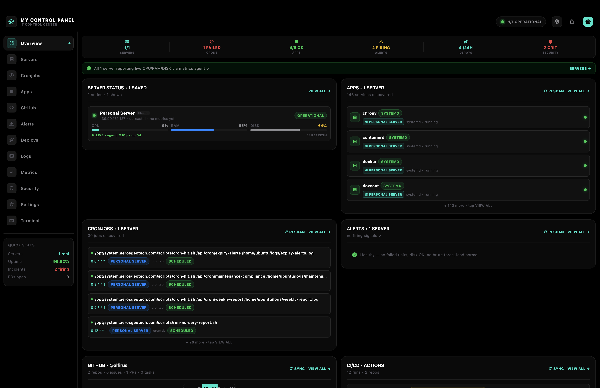
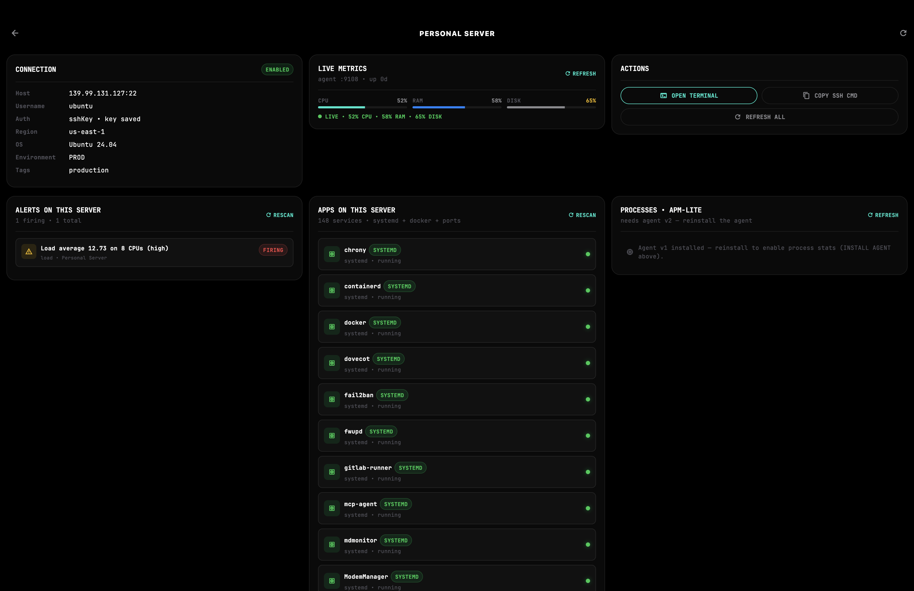

# MyControlPanel — IT Control Center

A pitch-black, cross-platform **IT Control Center** built with Flutter.
Runs on **macOS, Windows, Linux, iOS, and Android** from a single codebase.

Connect your servers (SSH password or key) and monitor them live:
server metrics, cronjobs, running apps, alert signals — plus GitHub
activity, CI/CD, log tail, and an AI assistant with full control-center context.


## Screenshots

| Overview | Server details |
|---|---|
|  |  |

To capture them:

```bash
flutter run -d macos   # or windows / linux
# resize window to ~1600x1000, open Overview, screenshot to docs/screenshots/overview.png
# open a Server Details screen, screenshot to docs/screenshots/server-details.png
```

## What works today vs what's mock

**Live over SSH (real):**
Server metrics (CPU/RAM/disk, latency, uptime), cronjob discovery
(`crontab`, `/etc/crontab`, `/etc/cron.d/*`), running apps (systemd,
Docker, listening ports), alert harvesting (failed units, disk ≥80/90%,
brute-force, load, kernel errors, reboots), one-click metrics-agent
install, built-in SSH + local terminal.

**UI-ready, API still to wire (honest mock):**
GitHub issues/PRs, CI/CD timeline, security findings, AI chat replies,
log-tail stream. All screens and models exist; API wiring is on the roadmap.

## Features

| Segment | What it does | Data source |
|---|---|---|
| **Server Status** | CPU / RAM / DISK bars, sparklines, latency, uptime, status dots | Metrics agent (`:9108`) or demo |
| **Cronjobs** | Schedules discovered live (`crontab`, `/etc/crontab`, `/etc/cron.d/*`) | SSH discovery |
| **Apps** | Running services (systemd), Docker containers, listening ports | SSH discovery |
| **Alerts** | Failed units, disk ≥80/90%, SSH brute force, load, kernel errors, reboots | SSH harvest |
| **Terminal** | Built-in SSH + local shell, per-server sessions | `dartssh2` / `Process` |
| **GitHub** | Issues / PRs / Tasks tabbed view | Mock (API-ready) |
| **CI/CD & Deployments** | Deployment timeline with success/failed/running | Mock (API-ready) |
| **Live Log Tail** | Streaming terminal (`:050505`) with level filters | Simulated stream |
| **Metrics & Uptime** | Latency p95 chart + Uptime/p95/Errors/Req-min KPIs | Agent + mock |
| **Security Watch** | Findings with severity + category | Mock (API-ready) |
| **AI Chatbox** | Floating assistant aware of all segments | Mock replies (LLM-ready) |
| **Settings** | Server connections (password / SSH key / token), app prefs | `SharedPreferences` |

### Server Details

Tapping any server (Overview or Servers tab) opens a **Server Details** screen —
3-column layout on desktop — with Connection, Live Metrics, Alerts, Apps,
Cronjobs (each capped at 10 with a **View All** full-list screen), and Actions
(Open Terminal, Copy SSH command, Refresh all).

## How it works

```
┌──────────────┐   SSH (:22)    ┌──────────────────┐
│ MyControlPanel│───────────────▶│  your server     │
│  (this app)   │                │                  │
│               │◀───────────────│  mcp-agent :9108 │
└──────────────┘  metrics JSON   │  (one-click      │
                                │   install)       │
                                └──────────────────┘
```

1. **Add a server** — Settings → Add Server (host, port, user, password or SSH key).
   Keys can be imported via file picker (sandbox-safe) or pasted as PEM content.
2. **Install the metrics agent** — one click per server card (password, key, or
   guided manual install). Installs a stdlib-only Python agent as a systemd
   unit, opens TCP `9108`, verifies `GET /metrics`.
3. **Everything populates** — metrics, crons, apps, alerts stream in over SSH;
   rescan manually or by switching tabs.

> Credentials are stored locally via `SharedPreferences`.
> Private keys imported via picker are stored as content, never as paths.

## Getting started

### Prerequisites

- [Flutter SDK](https://docs.flutter.dev/get-started/install) ≥ 3.41 (stable)
- macOS: Xcode 15+ (set `MACOSX_DEPLOYMENT_TARGET = 12.0`, already configured
  in `macos/Runner.xcodeproj` + `macos/Podfile`)
- Linux: `clang`, `cmake`, `ninja`, GTK dev headers
- Windows: Visual Studio with C++ toolchain

### Run

```bash
cd mycontrolpanel
flutter pub get

flutter run -d macos     # pitch-black desktop
flutter run -d ios       # iPhone
flutter run -d android
flutter run -d windows
flutter run -d linux
```

> On macOS, `flutter run` prints `Failed to foreground app; open returned 1`.
> Harmless — the app is running in the Dock; hot-reload (`r`) works normally.
> Or launch detached: `open build/macos/Build/Products/Debug/my_control_panel.app`

### Build release

```bash
flutter build macos --release
flutter build windows --release
flutter build linux --release
flutter build apk --release
flutter build ipa --release   # macOS + Xcode
```

### Verify

```bash
flutter analyze
flutter test
```

## Project layout

```
lib/
├── main.dart                  # entry, pitch-black MaterialApp
├── theme/app_theme.dart        # AppColors (#000 pitch black…) + ThemeData
├── models/
│   ├── mock_data.dart          # demo datasets (servers, crons, apps, …)
│   ├── server_connection.dart  # saved connection model (JSON <-> prefs)
│   ├── cron_entry.dart         # discovered crontab entry + parser
│   ├── app_entry.dart          # discovered app/service
│   └── alert_entry.dart        # harvested alert signal
├── services/
│   ├── agent_service.dart      # SSH install/verify metrics agent, fetch crons/apps/alerts/metrics
│   └── ssh_key_loader.dart     # PEM path-or-content loader, encrypted-key support
├── screens/
│   ├── control_center_screen.dart  # shell: rail, tabs, overview grid, 10 segments, AI drawer
│   ├── server_details_screen.dart  # 3-col detail: connection/metrics/alerts/apps/crons/actions
│   ├── settings_screen.dart        # server CRUD + prefs + integrations
│   └── terminal_screen.dart        # in-app SSH/local terminal
└── widgets/pitch_card.dart     # PitchCard, SectionHeader, StatusDot, MetricBar, Pill
```

## macOS notes

- `macos/Podfile` pins `platform :osx, '12.0'` and forces
  `MACOSX_DEPLOYMENT_TARGET = 12.0` on all pods (required by Xcode 27).
- Sandbox entitlements kept ON with `network.client`,
  `files.user-selected.read-only`, `files.downloads.read-only`.
  Consequence: typed `~/.ssh/…` paths can't be read — **import key files
  via the picker** (content is stored) or paste PEM directly.

## Roadmap

Release history: [CHANGELOG.md](CHANGELOG.md) · cutting a release:
[Release checklist](docs/releases.md).

- [ ] Background alert polling + push notifications (alert on new firing signals / failed CI runs while the app is closed)
- [ ] Biometric app lock enforcement (toggle persists; needs `local_auth` + lock screen)
- [ ] Sentry / Datadog integration (placeholder row in Settings)

<details>
<summary>Done</summary>

- [x] Real log tail — journal/syslog/docker over SSH per saved server (source + server picker, refresh on poll tick; demo heartbeat only when no servers)
- [x] Metrics history — per-host latency/CPU ring buffer (SharedPreferences, cap 120) + live chart and real p95 KPI
- [x] Foreground alert watcher — bell badge + snack on new firing alerts / failed CI runs (diffed against last-seen set)
- [x] Structured cronjob last-run tracking (log viewer per job + edit in place)
- [x] APM-lite — agent v2 `/procstats`: top processes by CPU + per-port connections, surfaced in Apps + Server Details
- [x] Secure credentials — `flutter_secure_storage` (Keychain/Keystore) for servers, PATs, AI keys, with SharedPreferences migration
- [x] GitHub Projects v2 (GraphQL) for the Tasks tab, with assigned-issue fallback
- [x] In-app updates from GitHub Releases (Windows/Linux/macOS)
- [x] Streaming chat responses (SSE/NDJSON per provider) + Anthropic/Gemini-native and Ollama tool calling
- [x] AI audit trail (append-only, capped at 200, filter + history viewer in chat drawer)

</details>

Feedback and PRs welcome — especially homelab/self-hosted setups.

## License

MIT — see [LICENSE](LICENSE).
