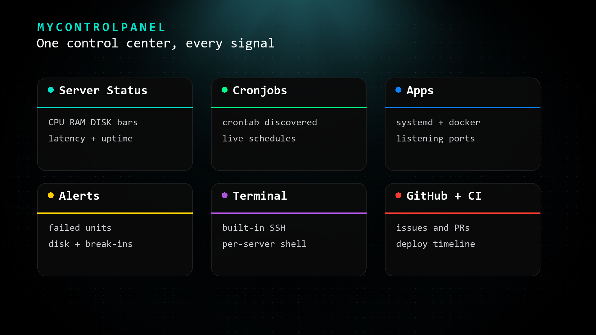
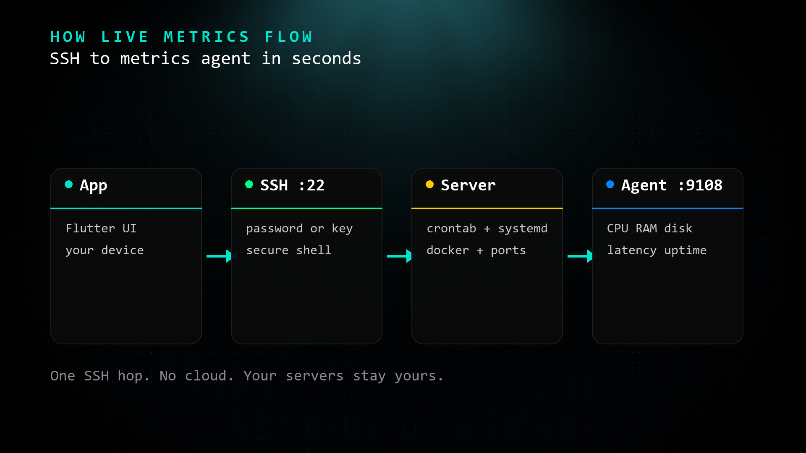

# MyControlPanel — IT Control Center

A pitch-black, cross-platform **IT Control Center** built with Flutter.
Runs on **macOS, Windows, Linux, iOS, and Android** from a single codebase.

Connect your servers (SSH password or key) and monitor them live:
server metrics, cronjobs, running apps, alert signals — plus GitHub
activity, CI/CD, log tail, and an AI assistant with full control-center context.


## Screenshots

| Overview | Server details |
|---|---|
|  |  |

| Laptop | Phone |
|---|---|
|  |  |

To capture them:

```bash
flutter run -d macos   # or windows / linux
# resize window to ~1600x1000, open Overview, screenshot to docs/screenshots/overview.png
# open a Server Details screen, screenshot to docs/screenshots/server-details.png
```

## What works today vs what's next

| Security findings | ◻️ UI-ready | Screens + models exist; API wiring on roadmap |

Legend: ✅ works today · ◻️ UI-ready, API still to wire.
Roadmap items (background polling, biometric lock, Sentry/Datadog) are tracked
in [Roadmap](#roadmap) below — nothing above is presented as live unless it is.
Full per-screen matrix + phased plan: [docs/roadmap.md](docs/roadmap.md).

## Features

| Segment | What it does | Data source |
|---|---|---|
| **Server Status** | CPU / RAM / DISK bars, sparklines, latency, uptime, status dots | Metrics agent (`:9108`) or demo |
| **Cronjobs** | Schedules discovered live (`crontab`, `/etc/crontab`, `/etc/cron.d/*`) | SSH discovery |
| **Apps** | Running services (systemd), Docker containers, listening ports | SSH discovery |
| **Alerts** | Failed units, disk ≥80/90%, SSH brute force, load, kernel errors, reboots | SSH harvest |
| **Terminal** | Built-in SSH + local shell, per-server sessions | `dartssh2` / `Process` |
| **GitHub** | Issues / PRs / Tasks tabbed view | UI-ready (API wiring on roadmap) |
| **GitLab** | Issues / MRs / Tasks, API-backed with mock fallback | Live API + fallback |
| **CI/CD & Deployments** | Deployment timeline with success/failed/running | Demo data (wiring on roadmap) |
| **Live Log Tail** | Real journal/syslog/docker tail over SSH (`:050505` stream) with level filters | Live over SSH; demo heartbeat with no servers |
| **Metrics & Uptime** | Latency p95 chart + Uptime/p95/Errors/Req-min KPIs | Agent + mock |
| **Security Watch** | Findings with severity + category | UI-ready (API wiring on roadmap) |
| **AI Chatbox** | Streaming assistant aware of all segments, tool calling, audit trail | Live (bring provider key / Ollama) |
| **Settings** | Server connections (password / SSH key / token), app prefs | OS keychain via `SecureStore` (`flutter_secure_storage`, Keychain/Keystore); prefs hold only `secure:` markers |



### Server Details

Tapping any server (Overview or Servers tab) opens a **Server Details** screen —
3-column layout on desktop — with Connection, Live Metrics, Alerts, Apps,
Cronjobs (each capped at 10 with a **View All** full-list screen), and Actions
(Open Terminal, Copy SSH command, Refresh all).

## How it works

```
┌──────────────┐   SSH (:22)    ┌──────────────────┐
│ MyControlPanel│───────────────▶│  your server     │
│  (this app)   │                │                  │
│               │◀───────────────│  mcp-agent :9108 │
└──────────────┘  metrics JSON   │  (one-click      │
                                │   install)       │
                                └──────────────────┘
```



### Read-only by enforcement, not by promise

The app only reads by design — but design is a promise, and promises don't
stop writes. Enforcement does: connect with a dedicated `monitor` user that
has no sudo and key-only SSH, so the OS itself refuses anything but reads.
Metrics need no SSH whatsoever — they come from the agent's `GET /metrics`
on `:9108`. Full setup (account, permissions, one-command revoke):
[read-only access runbook](docs/runbooks/read-only-access.md).

1. **Add a server** — Settings → Add Server (host, port, user, password or SSH key).
   Keys can be imported via file picker (sandbox-safe) or pasted as PEM content.
2. **Install the metrics agent** — one click per server card (password, key, or
   guided manual install). Installs a stdlib-only Python agent as a systemd
   unit, opens TCP `9108`, verifies `GET /metrics`.
3. **Everything populates** — metrics, crons, apps, alerts stream in over SSH;
   rescan manually or by switching tabs.

> Server credentials, passwords, private keys (stored as content, never paths),
> API tokens, and AI keys live in the OS keychain/keystore via `SecureStore`
> (`flutter_secure_storage`, migrated one-time from legacy prefs on first launch).
> Tokens are per-host; nothing secret is committed — CI runs gitleaks.
>
> Full contract: [Metrics Agent API reference](docs/agent-api.md).

## Getting started

Server setup, SSH keys, agent install, and troubleshooting live in the
[Setup + operations guide](docs/setup.md).

### Prerequisites

- [Flutter SDK](https://docs.flutter.dev/get-started/install) ≥ 3.41 (stable)
- macOS: Xcode 15+ (set `MACOSX_DEPLOYMENT_TARGET = 12.0`, already configured
  in `macos/Runner.xcodeproj` + `macos/Podfile`)
- Linux: `clang`, `cmake`, `ninja`, GTK dev headers
- Windows: Visual Studio with C++ toolchain

### Run

```bash
cd mycontrolpanel
flutter pub get

flutter run -d macos     # pitch-black desktop
flutter run -d ios       # iPhone
flutter run -d android
flutter run -d windows
flutter run -d linux
```

> On macOS, `flutter run` prints `Failed to foreground app; open returned 1`.
> Harmless — the app is running in the Dock; hot-reload (`r`) works normally.
> Or launch detached: `open build/macos/Build/Products/Debug/my_control_panel.app`

### Build release

```bash
flutter build macos --release
flutter build windows --release
flutter build linux --release
flutter build apk --release
flutter build ipa --release   # macOS + Xcode
```

### Verify

```bash
flutter analyze
flutter test
```

See [`docs/release-gate.md`](docs/release-gate.md) for the full release gate
and v1 acceptance criteria — no release ships until every box is checked.

## Project layout

```
lib/
├── main.dart                  # entry, pitch-black MaterialApp
├── theme/app_theme.dart        # AppColors (#000 pitch black…) + ThemeData
├── models/
│   ├── mock_data.dart          # demo datasets (servers, crons, apps, …)
│   ├── server_connection.dart  # saved connection model (JSON <-> prefs)
│   ├── cron_entry.dart         # discovered crontab entry + parser
│   ├── app_entry.dart          # discovered app/service
│   └── alert_entry.dart        # harvested alert signal
├── services/
│   ├── agent_service.dart      # SSH install/verify metrics agent, fetch crons/apps/alerts/metrics
│   └── ssh_key_loader.dart     # PEM path-or-content loader, encrypted-key support
├── screens/
│   ├── control_center_screen.dart  # shell: rail, tabs, overview grid, 10 segments, AI drawer
│   ├── server_details_screen.dart  # 3-col detail: connection/metrics/alerts/apps/crons/actions
│   ├── settings_screen.dart        # server CRUD + prefs + integrations
│   └── terminal_screen.dart        # in-app SSH/local terminal
└── widgets/pitch_card.dart     # PitchCard, SectionHeader, StatusDot, MetricBar, Pill
```

## macOS notes

- `macos/Podfile` pins `platform :osx, '12.0'` and forces
  `MACOSX_DEPLOYMENT_TARGET = 12.0` on all pods (required by Xcode 27).
- Sandbox entitlements kept ON with `network.client`,
  `files.user-selected.read-only`, `files.downloads.read-only`.
  Consequence: typed `~/.ssh/…` paths can't be read — **import key files
  via the picker** (content is stored) or paste PEM directly.

## Roadmap

Release history: [CHANGELOG.md](CHANGELOG.md) · cutting a release:
[Release checklist](docs/releases.md).

Product direction: **ship v1 as the homelab/self-hosted IT Control Center** —
every tab live against real data — then grow v2 platform depth.
Tracked under milestones
[v1-ship](https://github.com/alfirus/mycontrolpanel/milestone/1) and
[v2-next](https://github.com/alfirus/mycontrolpanel/milestone/2).

### v1-ship (current milestone) — make every tab real

- [ ] Wire GitHub tab to `GithubService` (live issues/PRs/Tasks over PAT; demo fallback when no token)
- [ ] Wire GitLab tab to `GitlabService` (live projects/issues/MRs; demo fallback when no token)
- [ ] Wire CI/CD tab to live GitHub Actions runs (replace `mockDeploys`)
- [ ] Wire Security tab to live findings (Dependabot/code-scanning via `GithubService`; demo fallback)
- [ ] Live log-tail stream over SSH (replace simulated stream)
- [ ] Release gate green per [`docs/release-gate.md`](docs/release-gate.md)
  (`flutter analyze`, `flutter test`, 5-platform builds, agent install,
  secure-storage migration verified)

### v2-next — platform depth

- [ ] Background alert polling + push notifications (alert on new firing signals / failed CI runs while the app is closed)
- [ ] Sentry / Datadog integration (placeholder row in Settings)

<details>
<summary>Done</summary>

- [x] Real log tail — journal/syslog/docker over SSH per saved server (source + server picker, refresh on poll tick; demo heartbeat only when no servers)
- [x] Metrics history — per-host latency/CPU ring buffer (SharedPreferences, cap 120) + live chart and real p95 KPI
- [x] Foreground alert watcher — bell badge + snack on new firing alerts / failed CI runs (diffed against last-seen set)
- [x] Structured cronjob last-run tracking (log viewer per job + edit in place)
- [x] APM-lite — agent v2 `/procstats`: top processes by CPU + per-port connections, surfaced in Apps + Server Details
- [x] Secure credentials — `flutter_secure_storage` (Keychain/Keystore) for servers, PATs, AI keys, with SharedPreferences migration
- [x] GitHub Projects v2 (GraphQL) for the Tasks tab, with assigned-issue fallback
- [x] In-app updates from GitHub Releases (Windows/Linux/macOS)
- [x] Streaming chat responses (SSE/NDJSON per provider) + Anthropic/Gemini-native and Ollama tool calling
- [x] Biometric app lock enforcement (`local_auth` + lock screen on launch/resume, device-PIN fallback)
- [x] AI audit trail (append-only, capped at 200, filter + history viewer in chat drawer)

</details>

Feedback and PRs welcome — especially homelab/self-hosted setups.

## Positioning

 MyControlPanel is **free and open source (MIT)** for homelab and self-hosted
 use — public repo, unlimited servers, no paywall, no telemetry, no account.
 It is sustained by voluntary donations
 ([Buy Me a Coffee](https://www.buymeacoffee.com/alfirus)).

 ## Pricing

 **Community (MIT) is the only edition today** — free, unlimited servers,
 public repo. Pro and MSP bundles are *proposed* post-traction concepts with
 no prices and no sale dates yet. Full tier framing: [docs/packaging.md](docs/packaging.md).
 License decision ratified: [`docs/decisions/002-commercial-packaging.md`](docs/decisions/002-commercial-packaging.md).

## License

MIT — see [LICENSE](LICENSE).
