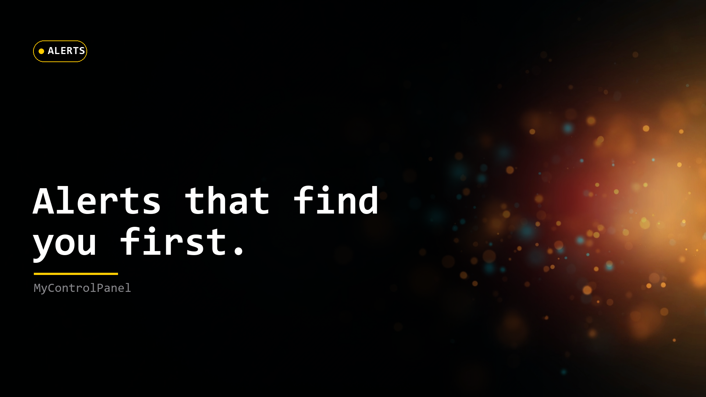
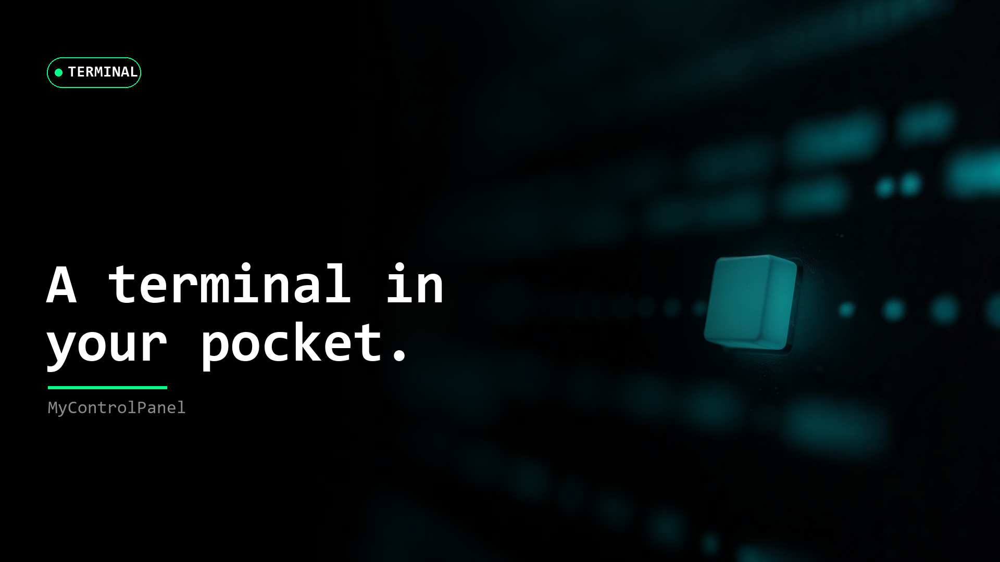
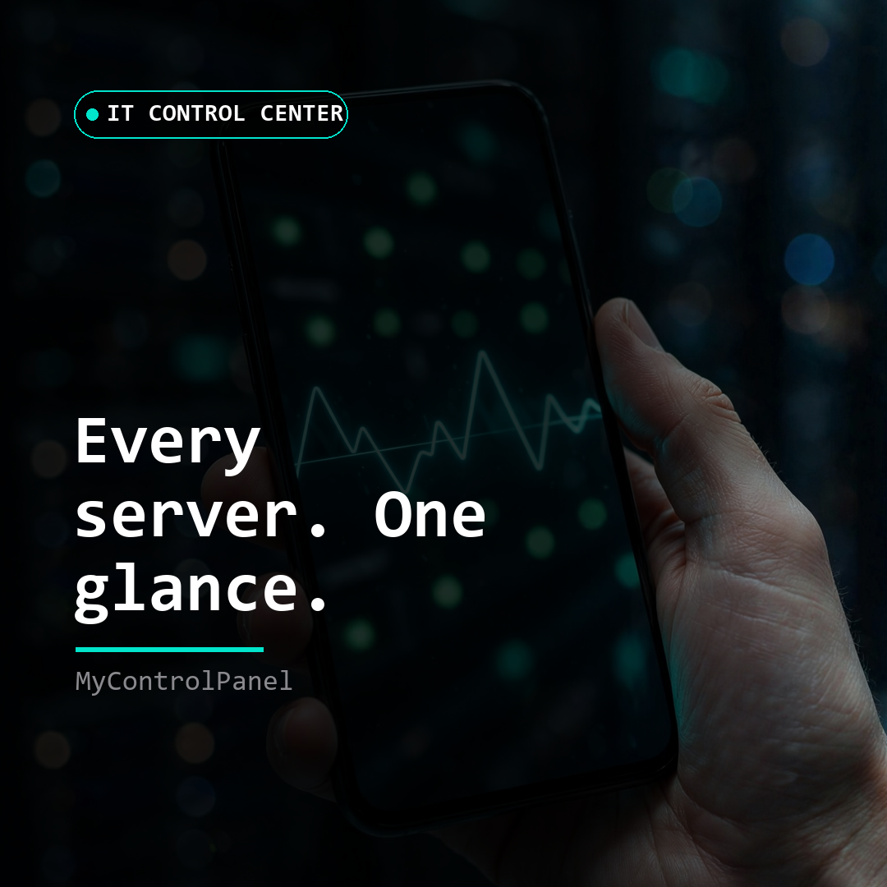

# Social teaser series — MyControlPanel

Consistent 16:9 + 1:1 launch cards in the pitch-black brand palette
(`lib/theme/app_theme.dart` AppColors; mono type). Bases generated on
the Muse Image pipeline (`muse-image-1.0`, text-free prompts); headlines
overlaid locally for typo-free legibility.

| Card | File | Size | Accent |
|---|---|---|---|
| Server Status — "Every box. One glance." | `assets/marketing/social/server-status-16x9.png` | 1920x1080 | cyan `#00E5CC` |
| Alerts — "Alerts that find you first." | `assets/marketing/social/alerts-16x9.png` | 1920x1080 | amber `#FFCC02` |
| Terminal — "A terminal in your pocket." | `assets/marketing/social/terminal-16x9.png` | 1920x1080 | green `#00FF88` |
| Spotlight (square) — "Every server. One glance." | `assets/marketing/social/spotlight-1x1.png` | 1080x1080 | cyan `#00E5CC` |

